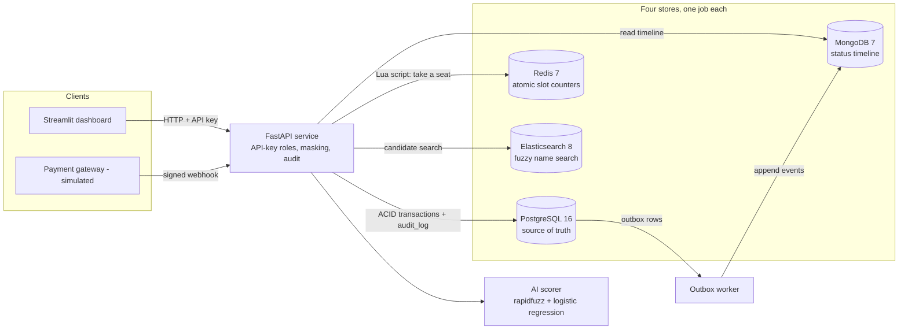
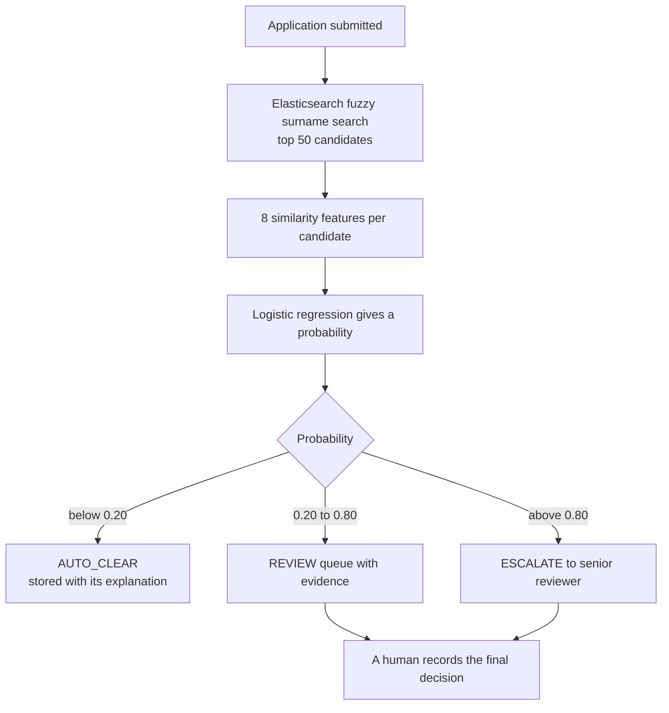

# NBI Clearance PoC: polyglot data architecture + AI-assisted HIT matching

A **proof of concept** for a course case study (AODB) on the NBI Clearance Appointment and
Renewal System in the Philippines. It shows that a polyglot data architecture plus an
AI-assisted match scorer, with **a human always making the final decision**, can cut manual
HIT reviews without wrongly clearing a true match.

> **All data is synthetic. This is a prototype, not NBI's real system.** The AI only scores,
> ranks, and explains. It never issues a "criminal record" decision.

## Quick start (9 commands)

Requirements: Windows 11 + PowerShell, Python 3.11, Docker Desktop (running), Git.
On macOS use `python3.11 -m venv .venv`, `source .venv/bin/activate`, and `cp .env.example .env`.

<!-- setup:start -->
```powershell
py -3.11 -m venv .venv
.\.venv\Scripts\Activate.ps1
pip install -r requirements.txt
Copy-Item .env.example .env
docker compose up -d
python -m scripts.bootstrap --demo-data
uvicorn app.main:app
# open a SECOND terminal in the same folder, then:
.\.venv\Scripts\Activate.ps1
streamlit run dashboard/streamlit_app.py
```
<!-- setup:end -->

`bootstrap` waits for the databases, creates the tables, generates and loads the synthetic data,
creates four demo users, trains the model (3 to 8 minutes the first time), and runs the HIT
check on 200 applications so the queue and analytics have something to show.
The dashboard opens at <http://localhost:8501>, the API docs at <http://127.0.0.1:8000/docs>.

Optional extras:
```powershell
python -m scripts.outbox_worker     # background retry of timeline delivery
pytest -v                           # 81 tests
python -m scripts.evaluate          # writes results.md and results.json (3 to 8 minutes)
```
Run the evaluation with `uvicorn`, the worker, and Streamlit **stopped**, so nothing else
writes audit rows while it counts them.

## Architecture



More diagrams (payment consistency, HIT pipeline) and the failure-handling table are in
[docs/architecture.md](docs/architecture.md).

### Why each store has one job

| Store | Job | Why this store |
|---|---|---|
| PostgreSQL | System of record: applicants, applications, appointments, payments, watchlist, hit cases, users, audit log, outbox | ACID transactions and database-enforced rules (one active booking per application, no decision without a human user, append-only audit log) |
| Redis | Real-time slot inventory | A Lua script checks and takes a seat in one uninterruptible step, so 50 simultaneous requests for the last seat produce exactly one winner |
| MongoDB | Status timeline, one document per application | Events vary in shape and are only ever appended, which suits flexible documents |
| Elasticsearch | Fuzzy candidate search on names | Typo-tolerant search is its specialty. It holds **names only**, never birthdates (data minimization) |

## How the AI matching works



Every score is explained: each feature's value, weight, and contribution add up exactly to the
model's log-odds. The database refuses to mark a case `DECIDED` unless a human user id is recorded.

## Results (synthetic held-out test split: 3,000 applicants, 150 true matches)

Full detail, both baselines, and the Findings table are in [results.md](results.md).

| Metric | Result | Target | Status |
|---|---|---|---|
| Manual reviews avoided vs baseline A (every fuzzy-name candidate) | 2,525 of 2,813 (89.8%) | at least 50% | PASS |
| Manual reviews avoided vs baseline B (exact first + last name) | 823 of 1,111 (74.1%) | none | info |
| Recall on true matches | 100% (150 of 150) | 100% | PASS |
| True matches wrongly cleared | 0 | 0 | PASS |
| Precision (sent to a human that are true matches) | 52.1% | none (trade-off) | info |
| Double-booking count | 0 | 0 | PASS |
| Average status-update delay | 0.060 s | under 5 s | PASS |
| Audit-log coverage | 100% (24 of 24 calls) | 100% | PASS |

Targets were set by this PoC, not by NBI. "0 misses in 150" does not prove zero risk: the 95%
upper bound on the true miss rate is about 2%. Results are **indicative, not predictive**.

## Roles (API key in the `X-API-Key` header)

| Endpoint | applicant | frontdesk | reviewer | admin |
|---|---|---|---|---|
| `POST /applicants`, `POST /appointments`, `POST /applications/{ref}/payments` | yes | yes | no | yes |
| `GET /slots` | yes | yes | yes | yes |
| `GET /applications/{ref}/status` | public status | public status | internal status | internal status |
| `GET /applications/{ref}` | no | masked (no birthdate, no evidence) | full | full |
| `POST /applications/{ref}/hit-check`, `GET /review-queue`, `GET /hit-cases/{id}`, `POST /review-queue/{id}/decision`, `GET /analytics/summary` | no | no | yes | yes |
| `GET /audit-log` | no | no | no | yes |
| `POST /webhooks/payment` | HMAC signature only (audited as `payment-gateway`) | | | |

Demo keys are in `.env.example`. Every guarded call, allowed or denied, writes one row to
`audit_log` before any work is done (fail closed).

## The five demo scenarios

Each exists as an automated test **and** a dashboard button (the same code runs both).

| # | Scenario | Dashboard location | Test |
|---|---|---|---|
| 1 | 50 simultaneous requests, 1 seat: exactly one wins | Book appointment, expander | `tests/test_booking.py`, `tests/test_dashboard_scenarios.py` |
| 2 | Payment webhook updates PostgreSQL and the timeline within seconds | Applicant status timeline, expander | `tests/test_payment_webhook.py` |
| 3 | Common-name applicant: flagged, scored, cleared or queued | Staff review queue, tab "Demo 3" | `tests/test_hit_matching.py` |
| 4 | True match escalated, a human records the decision | Staff review queue, tab "Demo 4" | `tests/test_hit_matching.py` |
| 5 | Front desk masked, reviewer full, both audited | Analytics, tab "Governance and audit" | `tests/test_governance.py` |

A 5-minute walkthrough is in [docs/demo_script.md](docs/demo_script.md).

## Project layout

```
app/         FastAPI service: booking, payments, timeline, hit_check, auth, audit, analytics
ml/          features.py (8 similarity numbers), model.py (load, predict, explain)
scripts/     bootstrap, init_db, generate_data, load_data, seed_users, train_model,
             seed_hit_checks, outbox_worker, reconcile_slots, evaluate, health_check
dashboard/   Streamlit app + scenario functions (an API client, plus demo-only tools)
tests/       81 pytest tests
docs/        architecture, demo script, limitations, screenshot checklist
data/        generated CSVs (git-ignored; regenerated from seed 42)
```

## Everyday commands

```powershell
docker compose stop                          # stop the databases (keeps data)
docker compose start                         # start them again
python -m scripts.bootstrap --reload --demo-data   # fresh data + filled review queue
python -m scripts.reconcile_slots --fix      # repair Redis seat counters from PostgreSQL
docker compose down -v                       # wipe everything (then run the quick start again)
```

## Limitations (short version)

Synthetic names do not reflect real Filipino name distributions; true matches always keep at
least one exact identifier; there is no integration with NBI systems, payment gateways, or
biometric hardware; the dashboard role switcher is not a login; results are indicative, not
predictive. The full, honest list is in [docs/limitations.md](docs/limitations.md).

## Data privacy note

The PoC applies privacy-by-design ideas relevant to the Data Privacy Act of 2012 (RA 10173):
data minimization, role-based masking, an append-only audit log, hashed API keys, and no
personal data in logs. It uses synthetic data only and is **not** a compliance assessment.