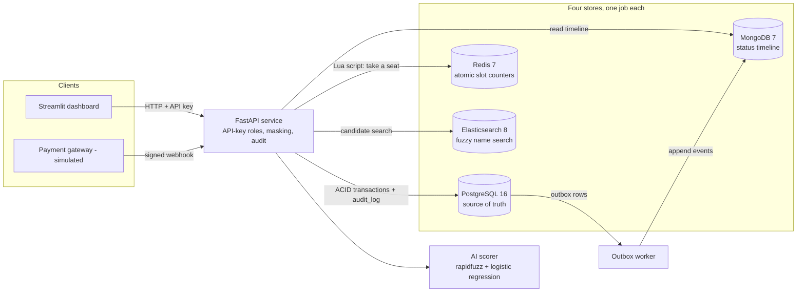
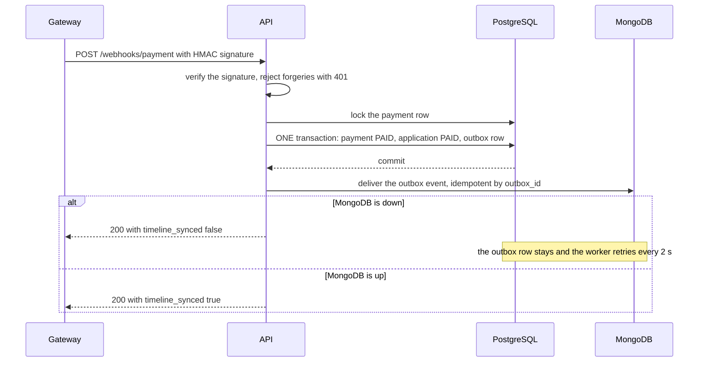
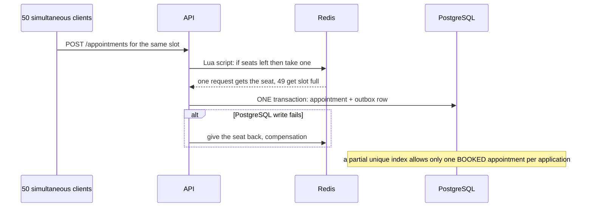
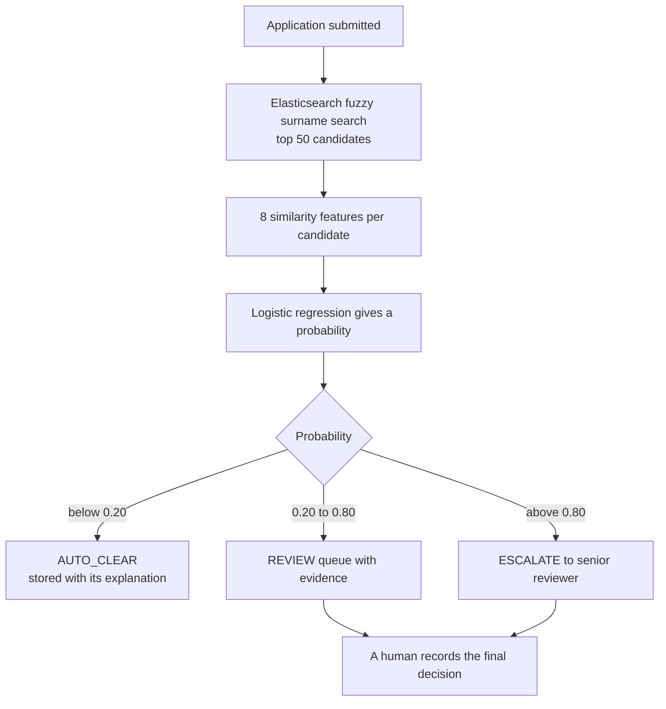

# Architecture

All data is synthetic. This is a prototype, not NBI's real system.

## 1. Components

## 2. Payment webhook: keeping PostgreSQL and MongoDB consistent

## 3. Booking the last seat

## 4. HIT pipeline

## 5. Failure handling

| What fails | What happens | Where it is tested |
|---|---|---|
| PostgreSQL write fails after Redis took a seat | The seat is released immediately | `tests/test_booking.py` |
| Server crashes between the Redis step and the commit | A seat is lost in Redis. `reconcile_slots` repairs it from PostgreSQL | `tests/test_booking.py` |
| MongoDB is down during a webhook | PostgreSQL stays correct, the outbox row stays, the worker retries, status shows `pending_sync` | `tests/test_payment_webhook.py` |
| The gateway resends a webhook, even 10 at once | Applied exactly once (event id is unique, row is locked) | `tests/test_payment_webhook.py` |
| Elasticsearch is down during a HIT check | The check returns 503 and nothing is written | `app/hit_check.py` |
| The audit row cannot be written | The request fails and no data is returned (fail closed) | `tests/test_governance.py` |
| Someone tries to edit the audit log | A database trigger refuses the UPDATE or DELETE | `tests/test_schema.py` |
| A decision is recorded without a human user | A database CHECK constraint rejects it | `tests/test_schema.py` |

## 6. Design decisions worth defending

- **PostgreSQL is the truth.** Redis counters and MongoDB timelines are rebuildable working copies.
- **Outbox pattern.** The business change and the event are saved in one transaction, so an event is never lost and never invented.
- **Human in the loop, enforced three ways.** The AI code path never writes a final decision, the decision endpoint needs a reviewer or admin key, and the database rejects a decision without a user id.
- **Privacy by design.** Elasticsearch holds names only, applicants and front desk get a public status, front desk gets a masked view, API keys are stored hashed, and the audit log holds no personal data.
- **The ground-truth answer key lives only in a CSV.** It is never loaded into any database and is joined only when grading.